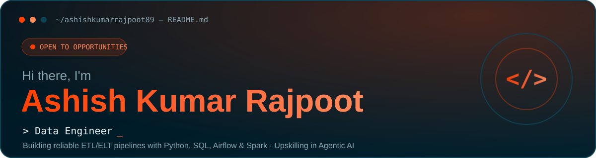
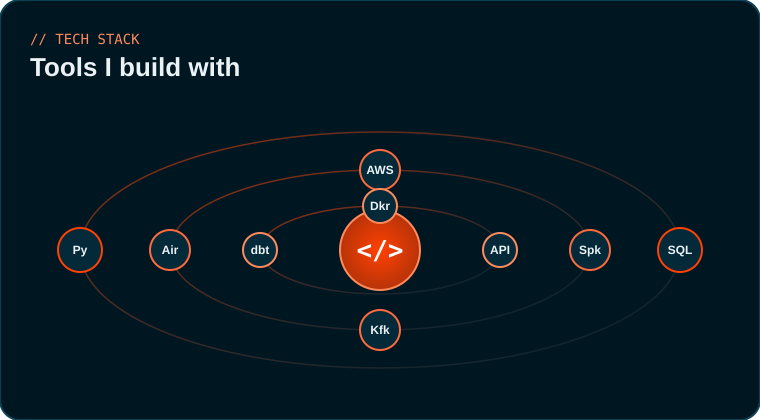

<!-- ===================== HERO BANNER ===================== -->

  
  
  
  

<!-- ===================== FEATURE CARDS ===================== -->
<table border="0">
  <tr>
    <td width="50%"></td>
    <td width="50%"></td>
  </tr>
</table>

<!-- ===================== ABOUT ===================== -->
## 👋 About Me

🔭 **Data Engineer** at **Samarth eGov (Ministry of Education, GoI)** — building Python ETL/ELT pipelines, SQL workflows and data-quality systems.
⚙️ Delivered a **seat-allocation engine** processing **1M+ records** (Python · SQL · Airflow · MySQL · ClickHouse · FastAPI), cutting manual work by **~50%+**.
🌱 Upskilling in **Agentic AI** — RAG, MCP, LangGraph, OpenAI Agents SDK.
📊 I turn messy data into reliable pipelines and clear insights.
🎓 B.Tech (CSE), Bundelkhand University, Jhansi.

### 🔎 What I Do
- 🔍 **Data Analysis** — cleaning, modeling and extracting insights
- 📊 **Data Visualization** — dashboards & reports with Power BI and Excel
- 💻 **Programming & Databases** — Python, SQL, Excel for automation
- 🎯 **Results-driven** — actionable recommendations aligned to business goals
- 🤖 **Generative AI** — adapting fast to new tech to drive strategy

<!-- ===================== TOOLS ORBITAL ===================== -->

  

### 🛠️ Full Stack

<!-- ===================== PROFILE AT A GLANCE ===================== -->
## 📊 Profile at a Glance

<table border="0">
  <tr>
    <td width="38%" align="center" valign="top">
      
    </td>
    <td width="62%" valign="top">

</td>
  </tr>
</table>

  
  

<!-- ===================== PROJECTS ===================== -->
## 🚀 Featured Projects

| Project | What it does | Stack |
| --- | --- | --- |
| [Sales Demand Forecast](https://github.com/ashishkumarrajpoot89/Sales-Demand-Forecast) | End-to-end ML pipeline forecasting product sales demand | Python · scikit-learn |
| [Insurance Fraud Detection](https://github.com/ashishkumarrajpoot89/Insurance-Fraud-detection) | End-to-end ML pipeline detecting fraudulent claims | Python · scikit-learn |
| [Adventure Works Analytics](https://github.com/ashishkumarrajpoot89/Adventure_works_) | Sales analytics pipeline with dashboards | Python · MySQL · Power BI |
| [Olympics Analysis](https://github.com/ashishkumarrajpoot89/Olympics-Analysis-) | Interactive app analyzing 120 years of Olympics | Python · Streamlit |

## 📜 Certifications
- 📘 Data Science and Machine Learning — Ekeeda, School of Data Science
- 📗 Data Analytics — KEMO
- 📙 Construct Week Project — Masai

   
  

